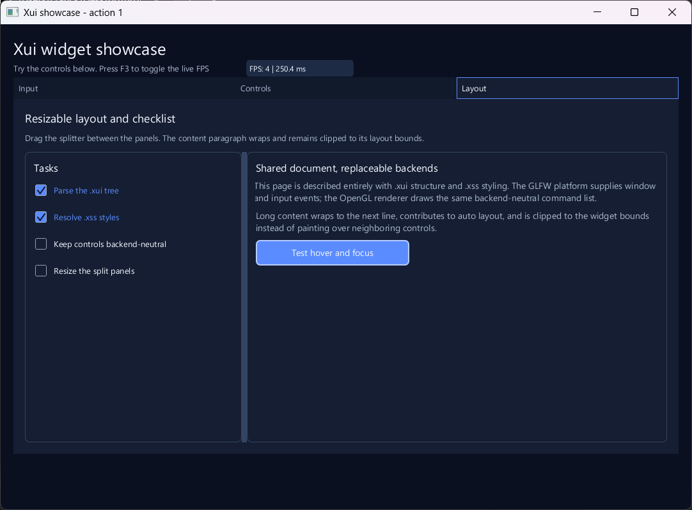

# Xui

Xui is an experimental C++23 UI framework. `.xui` files describe widget structure and layout; `.xss` files describe appearance. Applications connect those files to implementations of `xui::Renderer` and `xui::Platform`.

The bundled interactive example uses GLFW and OpenGL. Start with the [user documentation index](doc/README.md) for setup, file formats, widgets, and troubleshooting. Agent instructions, architecture notes, and the roadmap are in [`plan/`](plan/README.md); coding agents should read [`AGENTS.md`](AGENTS.md) first.

## Getting started

This example uses the GLFW/OpenGL backend targets from `backends/`. Put a TrueType font at `font.ttf`, then build the program with `xui_widgets`, `xui_backend_glfw`, and `xui_backend_opengl` linked. The CMake setup for the bundled demo is in [`examples/CMakeLists.txt`](examples/CMakeLists.txt); implementations are [`GlDrawListRenderer`](backends/opengl/gl_drawlist_renderer.hpp) and [`GlfwPlatform`](backends/glfw/glfw_platform.hpp).

`main.cpp`:

```cpp
#include <opengl/gl_drawlist_renderer.hpp>
#include <glfw/glfw_platform.hpp>
#include <xui/xui.hpp>
#include <iostream>

int main() {
    xui::XuiOptions options;
    options.windowTitle = "Xui button example";
    options.width = 480;
    options.height = 280;

    xui::Xui ui(options);
    if (!ui.loadFont("font.ttf") ||
        !ui.loadXui("button.xui") ||
        !ui.loadXss("button.xss")) {
        std::cerr << ui.lastError() << '\n';
        return 1;
    }

    GlDrawListRenderer renderer;
    GlfwPlatform platform;
    if (!ui.attach(renderer, platform)) {
        std::cerr << ui.lastError() << '\n';
        return 1;
    }
    return ui.run();
}
```

`button.xui`:

```xui
Window(title: "Button example", size: 480x280) {
  Column[class: "page"] {
    Text("Hello from Xui")[class: "heading"]
    Button(label: "Continue")[class: "primary", align: Center]
  }
}
```

`button.xss`:

```xss
Window { resting: { bg: #111827, fg: #f9fafb } }
Column.page { resting: { width: 100%, height: 100%, pad: 28px, gap: 18px } }
Text.heading { resting: { fg: #f9fafb, font-size: 24px, font-weight: 700 } }
Button.primary {
  resting: { bg: #2563eb, fg: #ffffff, size: 180px 44px, radius: 6px }
  hover: { bg: #3b82f6 }
  pressed: { opacity: 0.85 }
  disabled: { opacity: 0.5 }
}
```

For a complete build setup and asset instructions, see [Getting started](doc/getting-started.md). The sample uses the current `xui::Xui` facade; custom backends can implement the same [`Renderer`](doc/architecture.md#implement-xuirenderer) and [`Platform`](doc/architecture.md#implement-xuiplatform) interfaces.

## Showcase



The screenshot shows the themed showcase window with a tabbed layout, checklist, splitter, and live value readouts. The complete demo is defined in [`showcase.xui`](examples/showcase.xui) and [`showcase.xss`](examples/showcase.xss), and wired by [`glfw_demo.cpp`](examples/glfw_demo.cpp). See the [widget reference](doc/widgets.md) for supported controls and their behavior.

## Game UI example

[`examples/game/`](examples/game/README.md) contains a playable Tetris sample. Its board and controls use authored widgets; C++ owns game rules and updates values through the runtime API.

## Project links

- [Documentation index](doc/README.md): setup, `.xui`, `.xss`, widget and style references, architecture, performance, and troubleshooting.
- [Project plan](plan/plan.md): current status, risks, and roadmap.
- [Change tracking](plan/tracking.md): implementation decisions and verification history.
- [Contributing](CONTRIBUTING.md)
- [License](LICENSE.md)
